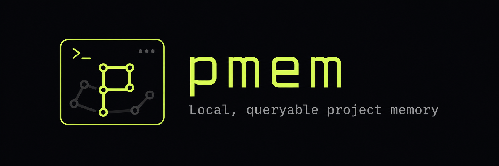
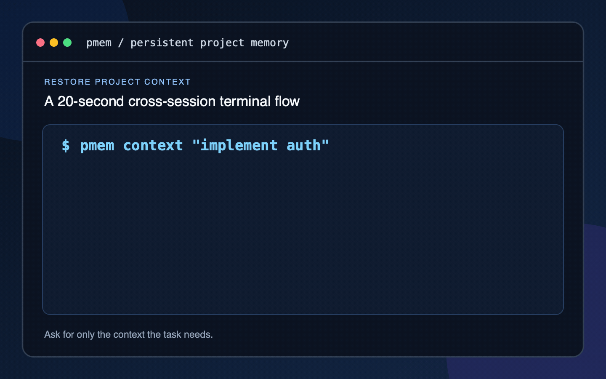
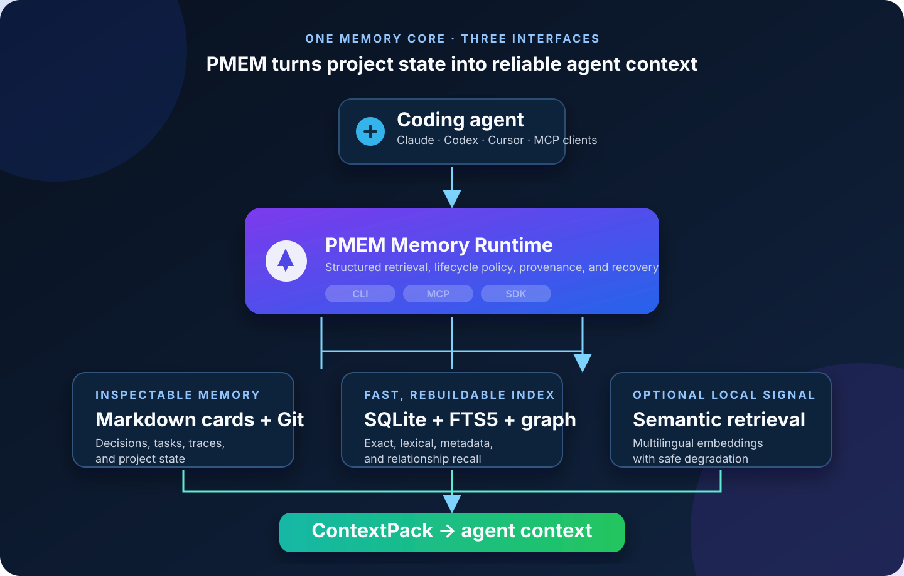

<p align="center">
  
</p>

<h1 align="center">PMEM</h1>

<p align="center">
  <strong>Persistent project memory for AI coding agents.</strong><br />
  Local-first · Git-friendly · CLI · SDK · MCP · Hybrid recall
</p>

<p align="center">
  <a href="https://www.npmjs.com/package/pmem-ai"></a>
  <a href="LICENSE"></a>
  <a href="https://nodejs.org"></a>
</p>

<p align="center">
  <a href="#install">Install</a> ·
  <a href="#quick-start">Quick start</a> ·
  <a href="#how-it-works">How it works</a> ·
  <a href="#commands">Commands</a>
</p>

<p align="center">
  
</p>

<p align="center"><sub>A 20-second flow. PMEM restores project context, records what changed, and hands it to the next agent session.</sub></p>

A coding agent can read your repository but cannot remember why it looks the way it does. PMEM gives the project a durable, queryable memory layer: what the project is, what changed, why, and what comes next. The next session starts with context instead of archaeology.

```bash
bun add -g pmem-ai@latest   # or: npm install -g pmem-ai@latest
cd your-project && pmem init
pmem context "add password reset"
```

## The problem

Every new agent session re-discovers the project from source files, issue threads, and half-remembered notes. Architecture decisions get lost, rejected approaches get retried, and "why is this like this" costs another hour.

The repository records *what the code does*. It does not record *what the project decided* — the constraints, the trade-offs already rejected, the risk you accepted on purpose, the task you stopped halfway through.

PMEM stores exactly that, as plain Markdown next to your code.

## What it does

- Restores context at the start of a session, within a token budget: `pmem context "<task>"`
- Answers questions across decisions, tasks, modules, and traces: `pmem ask "<question>"`
- Records what actually changed before you close a session: `pmem sync`
- Detects which memory cards a code change made stale: `pmem status`
- Checks that memory is consistent, fresh, and trustworthy: `pmem verify` / `pmem health`
- Finds relationships between cards, modules, and files: `pmem related`, `pmem discover`

Memory is written deliberately, by the agent or by you. It is not a transcript log, and it does not grow on its own.

## How it works



Three layers, one contract:

1. **Markdown cards are the source of truth.** Decisions, modules, tasks, risks, and traces live under `.pmem/` as readable, reviewable, Git-versioned files. Diffs are human diffs.
2. **SQLite is a rebuildable index.** FTS5/BM25, graph edges, and metadata are derived from the cards. Delete the database and `pmem rebuild` restores it. Nothing lives only inside it.
3. **One runtime, three surfaces.** The same retrieval core powers the CLI, the stdio MCP server (`pmem mcp`), and the TypeScript SDK — so an interactive session, an agent, and a script all see the same memory.

Retrieval is deterministic first: exact IDs, aliases, tags, source paths, and full-text search, then graph expansion and scoring. Optional local semantic retrieval adds recall for vague queries but never replaces the explainable path — if the model or index is unavailable, `ask`, `recall`, and `context` keep working.

## Install

```bash
bun add -g pmem-ai@latest
# npm install -g pmem-ai@latest also works
pmem --version
```

One package. It includes the complete CLI, the SQLite runtime, graph and semantic retrieval, health checks, the MCP server, and the SDK.

Requires Node.js ≥ 18. `better-sqlite3` compiles during install.

Verify the installation at any time with `pmem doctor`.

## Quick start

```bash
# 1. Initialize memory in a project
cd your-project
pmem init

# 2. Start a work session with context, inside a token budget
pmem session start -a "Claude Code"
pmem context "implement password reset"

# 3. ...do the work...

# 4. Record what changed and what comes next
pmem sync -s "added reset token flow" -n "verify token expiry"
pmem verify
```

Cards created by `pmem init`, `pmem sync`, and `pmem new` live in `.pmem/`. Commit them with your code — that is what makes memory survive a session, a machine, and a teammate.

## Agent integration

Connect an agent to the same memory it helps maintain:

```bash
pmem install --skills            # install pmem skill files for the agent
pmem install --agent-rules --claude   # or --codex / --cursor / --cline / --gemini
pmem mcp --write readonly        # stdio MCP server (readonly or append-only)
```

The MCP server exposes read-only recall, context, history, and diff tools by default, plus an append-only capture mode when you want the agent to write memory itself.

## Local semantic retrieval

Semantic search is optional, on-device, and never required.

```bash
pmem semantic setup --yes   # downloads the pinned model once (~145 MB)
pmem semantic rebuild       # builds this project's vector index
```

- Runs on CPU, no API key, no hosted vector database. Roughly **16 ms** of semantic work per query at 3,000 chunks, and about **8 seconds** to index that many on a modern desktop.
- The embedding model is pinned per project; upgrading it triggers a deliberate rebuild, never a silent one.
- On macOS and Windows the setup is guided. If the model is missing, retrieval falls back to the deterministic engine instead of failing.

## Design principles

- **Inspectable.** Memory is Markdown. You can read it, review it in a diff, and fix it in an editor.
- **Local-first.** No account, no cloud, no telemetry. Everything runs on your machine.
- **Explainable.** Every result carries the evidence that produced it: matched channels, scores, freshness, and provenance.
- **Safe to operate.** Operations are bounded and reversible where possible; destructive actions are confirmed, and health checks tell you when memory and code have drifted apart.

## Commands

| Command | What it does |
|---|---|
| `pmem init` | Initialize memory in the current project |
| `pmem session start` / `end` | Open and close a development session |
| `pmem context "<task>"` | Restore consolidated context for a task |
| `pmem ask "<query>"` | Hybrid memory recall: lexical, graph, and optional semantic |
| `pmem recall` | Quick project recall within a budget |
| `pmem status` | Show changed files and affected memory cards |
| `pmem sync` / `pmem update` | Record what changed in project memory |
| `pmem verify` / `pmem health` | Check memory consistency and freshness |
| `pmem rebuild` | Rebuild SQLite indexes from the Markdown cards |
| `pmem doctor` | Diagnose the local setup |
| `pmem semantic` | Manage optional local semantic retrieval |
| `pmem mcp` | Start the stdio MCP server |

Run `pmem <command> --help` for every flag, or `pmem install --skills` to give an agent the full workflow reference.

## If something looks off

```bash
pmem doctor     # is the installation and project setup healthy?
pmem rebuild    # rebuild derived indexes from the Markdown cards
pmem verify     # is memory consistent and in sync with the code?
```

Markdown cards are always the source of truth. Derived state can be deleted and rebuilt; your memory cannot be lost that way.

## Requirements

- Node.js ≥ 18 (the published package installs with any registry client)
- macOS, Windows, or Linux for the CLI and SDK; guided semantic setup currently targets macOS and Windows

## License

Apache-2.0. See [LICENSE](LICENSE).
